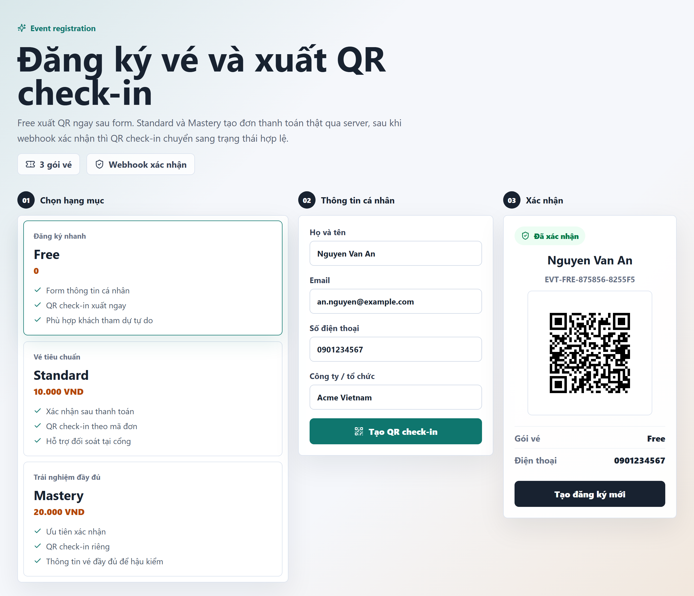
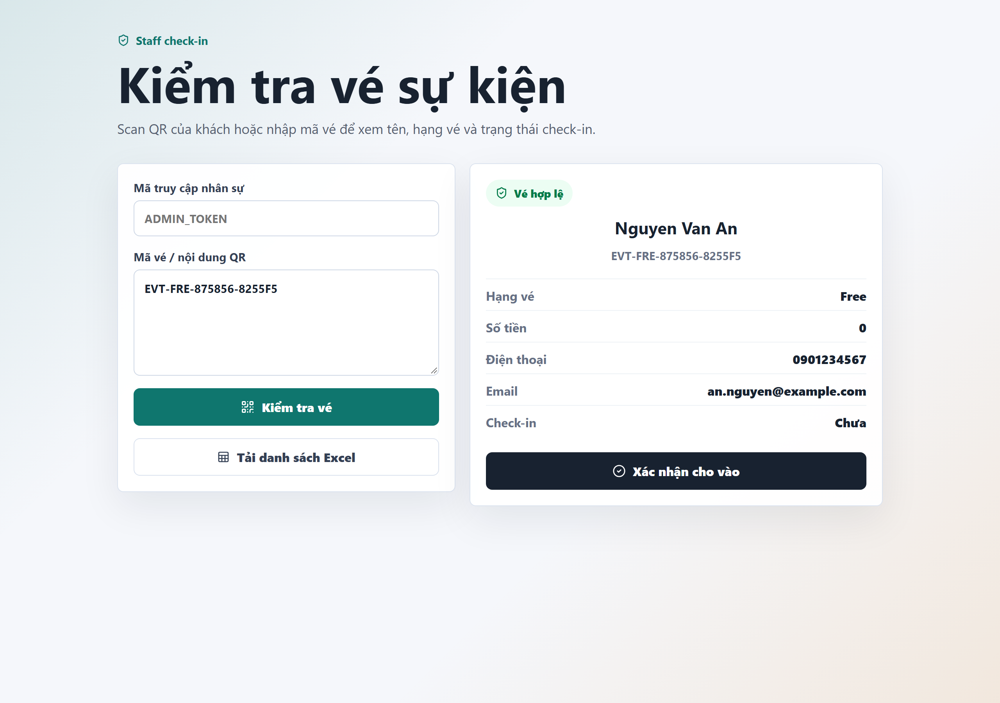
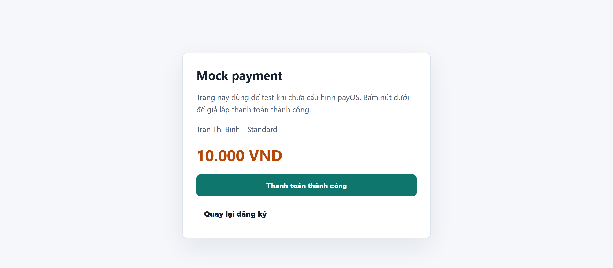

# Event Payment Registration

Web app đăng ký vé sự kiện kèm thanh toán và QR check-in tại cổng.

Khách chọn hạng vé → điền thông tin → nhận QR. Vé miễn phí xuất QR ngay, vé trả phí tạo đơn
payOS và chỉ chuyển sang trạng thái hợp lệ sau khi webhook xác nhận thanh toán. Nhân sự tại
sự kiện quét QR (hoặc nhập mã vé) để check-in, và tải được file Excel đối soát.

## Giao diện

**Đăng ký vé và nhận QR check-in** — chọn hạng vé, điền thông tin; vé miễn phí xuất QR ngay, vé
trả phí chờ webhook xác nhận.



**Check-in tại cổng** — nhân sự quét QR hoặc nhập mã vé để xem thông tin khách và xác nhận cho vào.



**Thanh toán** — chế độ mock checkout cho phép test toàn bộ luồng khi chưa cấu hình payOS.



## Tính năng

| Nhóm       | Chi tiết                                                                              |
| ---------- | ------------------------------------------------------------------------------------- |
| Đăng ký    | 3 hạng vé cấu hình sẵn (`free`, `standard`, `mastery`), validate họ tên / email / SĐT |
| Thanh toán | payOS payment link + QR, chế độ mock checkout khi chưa cấu hình payOS                 |
| Xác nhận   | Webhook payOS có kiểm tra chữ ký HMAC-SHA256, kèm API đối soát trạng thái             |
| Vé         | QR check-in theo mã đơn, mở lại vé bằng link `/?order=<mã đăng ký>` hoặc `/?orderCode=<mã đơn>` |
| Check-in   | Trang `/checkin` cho nhân sự: quét QR hoặc nhập mã, chặn check-in trùng               |
| Đối soát   | Xuất Excel tự động cập nhật (`/api/export/registrations.xlsx`)                        |
| Email      | Gửi email vé qua HTTP email API hoặc SMTP (tuỳ chọn, tắt được)                        |
| Lưu trữ    | Supabase (khuyến nghị) hoặc file JSON `data/registrations.json` khi chạy local        |

## Kiến trúc

```
Trình duyệt ──► React 19 + Vite (src/main.tsx)
                    │  /api/*
                    ▼
              Express 5 (server/index.mjs)
                    ├──► Supabase (bảng registrations, RLS bật)
                    ├──► payOS API (tạo payment link + webhook)
                    ├──► ExcelJS (file đối soát)
                    └──► email API / SMTP (gửi vé)
```

Frontend và backend nằm cùng một tiến trình Node: Express phục vụ thư mục `dist/` sau khi build.

## Chạy local

Yêu cầu Node 22 trở lên.

```bash
npm install
npm run build
npm run start
```

Mở http://127.0.0.1:8080. Khi chưa cấu hình payOS, các gói trả phí dùng mock checkout để test
toàn bộ luồng mà không cần tiền thật.

Chế độ phát triển giao diện:

```bash
npm run dev
```

## Biến môi trường

Sao chép `.env.example` thành `.env` rồi điền dần. Tất cả đều tuỳ chọn khi chạy local.

| Biến                                                       | Bắt buộc              | Mô tả                                                                    |
| ---------------------------------------------------------- | --------------------- | ------------------------------------------------------------------------ |
| `PORT`                                                     | không                 | Cổng server, mặc định `8080`                                             |
| `PUBLIC_BASE_URL`                                          | nên có                | URL public, dùng để tạo link vé và link webhook                          |
| `ADMIN_TOKEN`                                              | **nên có khi deploy** | Khoá cho các endpoint quản trị. Xem mục Bảo mật                          |
| `CORS_ORIGINS`                                             | không                 | Danh sách origin được phép, cách nhau dấu phẩy. Bỏ trống = không mở CORS |
| `PAYOS_CLIENT_ID` / `PAYOS_API_KEY` / `PAYOS_CHECKSUM_KEY` | không                 | Bật payOS thật. Thiếu thì dùng mock checkout                             |
| `SUPABASE_URL` / `SUPABASE_SERVICE_ROLE_KEY`               | không                 | Bật lưu trữ Supabase. Thiếu thì ghi ra file JSON                         |
| `EMAIL_API_*`                                              | không                 | Gửi email vé qua HTTP API                                                |
| `SMTP_*` / `MAIL_FROM`                                     | không                 | Gửi email vé qua SMTP                                                    |

## Bảo mật

Các endpoint dưới đây trả về dữ liệu cá nhân của khách hoặc thay đổi trạng thái vé, nên được
khoá bằng `ADMIN_TOKEN`:

- `GET /api/export/registrations.xlsx`
- `POST /api/checkin/:id/confirm`
- `POST /api/mock/pay/:id`
- `POST /api/email/test`

Gửi kèm một trong hai header:

```
Authorization: Bearer <ADMIN_TOKEN>
X-Admin-Token: <ADMIN_TOKEN>
```

Nếu `ADMIN_TOKEN` để trống, các endpoint này vẫn mở để tiện chạy local, và server sẽ in cảnh
báo lúc khởi động. **Luôn đặt `ADMIN_TOKEN` trước khi public app ra internet.**

Ngoài ra:

- Webhook payOS luôn kiểm tra chữ ký HMAC-SHA256 và so sánh bằng `crypto.timingSafeEqual`.
  Khi chưa cấu hình payOS, endpoint webhook trả `503` thay vì bỏ qua kiểm tra.
- CORS mặc định không mở. Chỉ bật khi khai báo `CORS_ORIGINS`.
- Có rate limit cho đăng ký, tra cứu vé và các endpoint quản trị.
- Supabase dùng `service_role` key ở server, RLS được bật sẵn trong `supabase-schema.sql`.
  Không bao giờ đưa key này vào code frontend.

## Deploy

Xem [DEPLOY.md](./DEPLOY.md). Bản ngắn: dùng `Dockerfile` và `render.yaml` có sẵn để deploy
lên Render, cấu hình webhook payOS trỏ về `https://<domain>/api/payos/webhook`.

## Cấu trúc thư mục

```
src/main.tsx              giao diện đăng ký và trang check-in
src/styles.css            style dùng chung
server/index.mjs          API Express, thanh toán, webhook, Excel, email
server/migrate-local-to-supabase.mjs  chuyển dữ liệu JSON lên Supabase
supabase-schema.sql       schema + index + RLS
DEPLOY.md                 hướng dẫn deploy chi tiết
```

## Scripts

| Lệnh                       | Việc                                   |
| -------------------------- | -------------------------------------- |
| `npm run dev`              | Vite dev server                        |
| `npm run build`            | Build frontend vào `dist/`             |
| `npm run start`            | Chạy server production                 |
| `npm run typecheck`        | Kiểm tra TypeScript                    |
| `npm run test`             | Chạy smoke test API (`node:test`)      |
| `npm run lint`             | Chạy ESLint                            |
| `npm run format`           | Định dạng bằng Prettier                |
| `npm run migrate:supabase` | Chuyển dữ liệu JSON local lên Supabase |

## Giấy phép

[MIT](./LICENSE)
